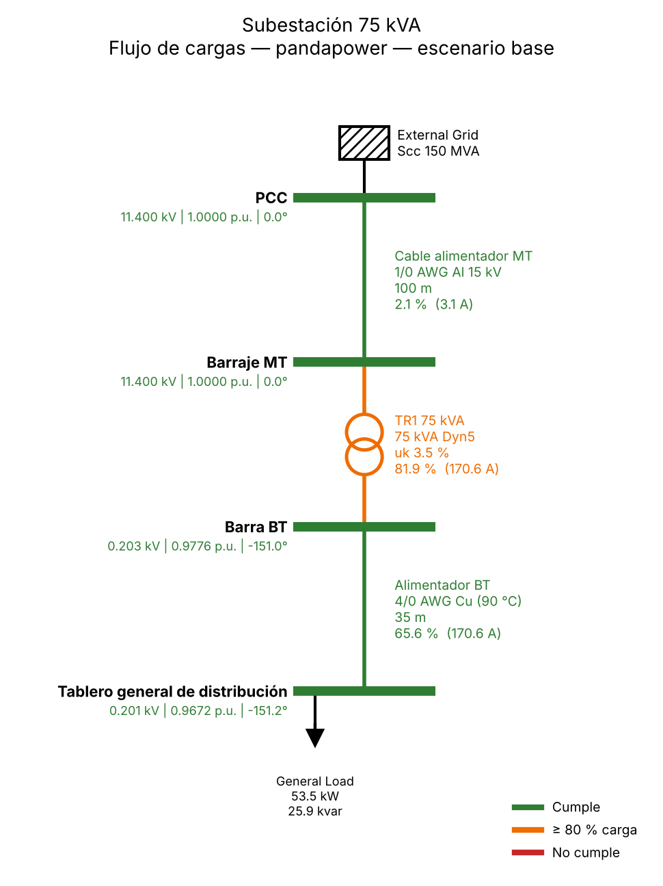

# power-studies-ai

Estudios eléctricos asistidos por agentes de IA, con **un solo modelo de red
para varias herramientas**: pandapower, OpenDSS, DIgSILENT PowerFactory,
ATP/ATPDraw, ETAP y PVsyst. Incluye verificación normativa colombiana
(RETIE, NTC 1340, NTC 2050) e informe técnico en Word generado automáticamente.

Caso piloto: la **subestación de 75 kVA** del Taller Integrador de Ingeniería
Eléctrica (UNAL).



## Idea central

```
 insumos (planos, fichas, exporte de PowerFactory, cuadro de cargas)
                           │  agentes: lector-insumos, modelador
                           ▼
              modelo neutro  modelo/red.yaml   ◄── única fuente de verdad
                           │
   ┌──────────┬────────────┼─────────────┬──────────┬─────────┐
pandapower  OpenDSS   PowerFactory      ATP       ETAP     PVsyst
 (local)    (local)   (API Python +   (plantilla (tablas de (modo
                       unifilar)       .atp)     importación) batch)
   └──────────┴────────────┼─────────────┴──────────┴─────────┘
                           ▼
       resultados en formato común → verificación normativa
                           → unifilar con resultados → informe .docx
```

- **Los números los calcula el código**, no el modelo de lenguaje. Los agentes
  orquestan, interpretan y redactan.
- **Nada se inventa en silencio**: cada dato lleva `origen: dato | deducido | supuesto`
  y el informe lista los supuestos.
- **Validación en cada paso**: el caso de 4 barras del informe del taller
  (Newton-Raphson verificado) es la prueba que toda herramienta debe pasar, y
  pandapower/OpenDSS se validan entre sí.
- **Puertas de aprobación**: el flujo se detiene en cada fase para el ingeniero.
  La firma del estudio es siempre humana.

## Qué funciona hoy

| Herramienta | Modelo | Simulación | Unifilar | Estado |
|---|---|---|---|---|
| pandapower | automático | flujo + cortocircuito IEC 60909 | propio (SVG/PNG) | ✅ probado, reproduce el informe del taller |
| OpenDSS | automático (`.dss`) | flujo | propio | ✅ probado, coincide con pandapower (Δu < 0,001 p.u.) |
| PowerFactory | automático (API Python) | flujo + cortocircuito | auto-diagramado o símbolos por posición | ⚠️ escrito y probado con API simulada; falta prueba con licencia |
| ATPDraw | automático (proyecto XML de ATPDraw ≥ 7.0) | ATP desde ATPDraw (F2) | dibujado por el adaptador | ✅ probado con ATPDraw 7.8 + tpbigm: reproduce el caso de 4 barras |
| ATP (plantilla) | plantilla del ingeniero + variables | en lote (`ATP_EXE`) | el de la plantilla | ⚠️ generación probada; ejecución depende de su ATP |
| ETAP | tablas para importación | en ETAP | ETAP | 🧪 columnas por ajustar a su versión |
| PVsyst | CSV de modo batch | en PVsyst | reportes de PVsyst | 🧪 por ajustar a su versión |

Detalle por herramienta, incluida la estrategia gráfica: [`docs/herramientas.md`](docs/herramientas.md).

## Inicio rápido

```bash
pip install -e ".[opendss,dev]"
python -m pytest                       # 21 pruebas, incluida la validación contra el informe

power-studies herramientas             # qué hay disponible en este equipo
power-studies validar   casos/subestacion_75kva/red.yaml
power-studies simular   casos/subestacion_75kva/red.yaml --escenario todos --cortocircuito
power-studies comparar  casos/subestacion_75kva/red.yaml --herramientas pandapower,opendss
power-studies informe   casos/subestacion_75kva/red.yaml --escenario todos --cruce opendss \
                        --cortocircuito --salida informe.docx
power-studies exportar  casos/subestacion_75kva/red.yaml --herramienta powerfactory --salida pf/
```

## Con agentes (Claude Code u OpenCode)

```text
/estudio-nuevo sub-75kva casos/subestacion_75kva/red.yaml
/estudio sub-75kva            # pipeline completo con gates
/estudio-continuar sub-75kva  # o una fase por vez
```

| Fase | Agente | Gate |
|---|---|---|
| 0 Insumos | `lector-insumos` | ¿insumos suficientes? |
| 1 Modelo | `modelador` | aprobar topología, parámetros y supuestos |
| 2 Simulación | `simulador` | resultados coherentes + validación cruzada |
| 3 Verificación | `analista-normativo` | criterios y alternativas simuladas |
| 4 Herramientas | `integrador-herramientas` | PowerFactory/ATP/ETAP/PVsyst coinciden |
| 5 Informe | `redactor-informe` → `revisor` | revisión final y firma |

Las fuentes de los agentes están en `.claude/`; la versión OpenCode se genera con
`python scripts/gen_opencode.py [--modelos modelos.json]` para usar cualquier
proveedor de modelos.

## Estructura

```
power_studies/          # librería: modelo, adaptadores, diagrama, normas, informe, CLI
herramientas/powerfactory/  # scripts que corren DENTRO de PowerFactory (solo stdlib)
plantillas/             # plantillas ATP / ETAP / PVsyst con marcadores {{VARIABLE}}
casos/                  # ejemplo_4_barras (validación) y subestacion_75kva (piloto)
.claude/ .opencode/     # agentes y comandos
tests/                  # pytest, incluida una API simulada de PowerFactory
docs/                   # arquitectura, herramientas, guía PowerFactory
```

## Próximos pasos

1. Correr `herramientas/powerfactory/pf_exportar_modelo.py` en el proyecto real
   del taller para reemplazar los parámetros supuestos (`power-studies importar-pf`).
2. Probar `pf_construir_red.py` con su versión de PowerFactory y ajustar los
   nombres de símbolos del unifilar si hace falta.
3. Coordinación de protecciones (curvas tiempo-corriente) como módulo nuevo.
4. Plantilla ATP del caso real y tablas de importación de ETAP según su versión.
