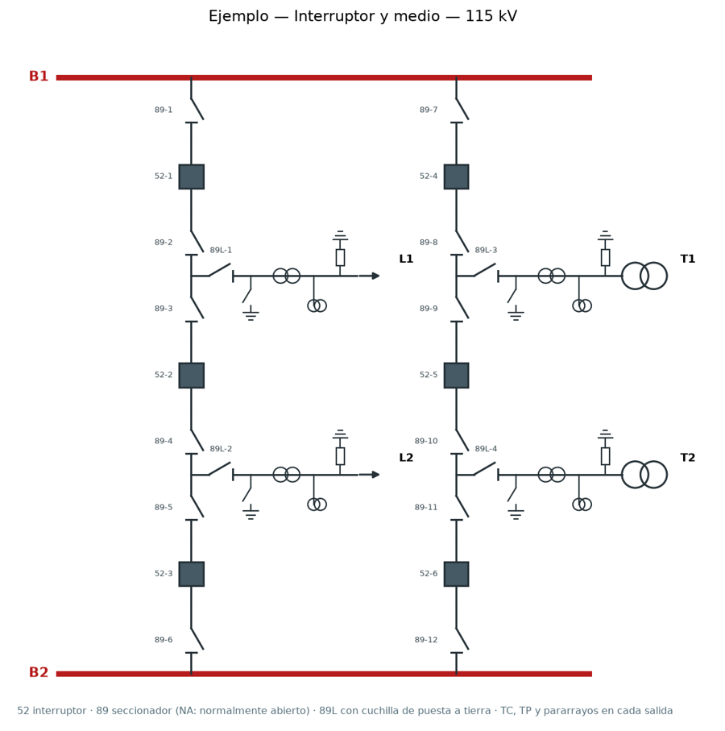
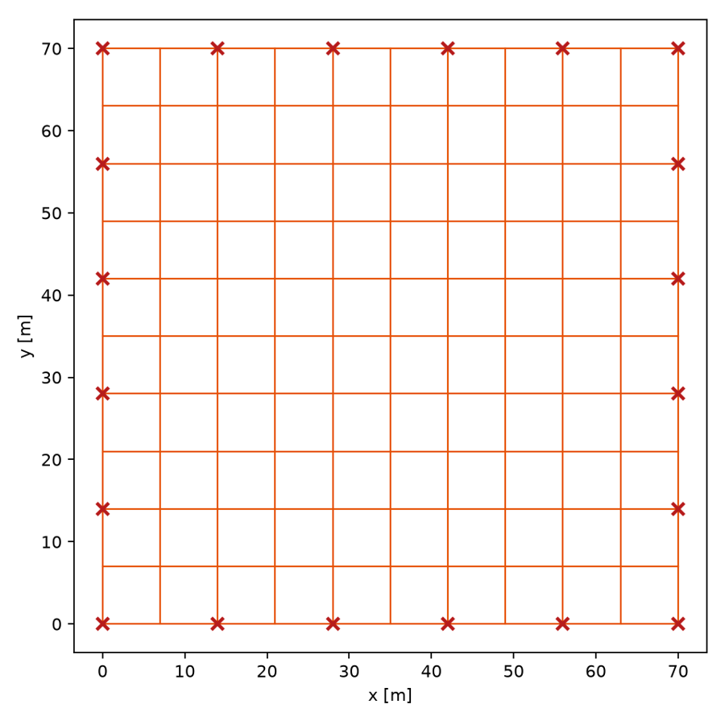

# power-studies-ai

Estudios eléctricos de distribución y subestaciones **desde un solo modelo de red**:
flujo de cargas, cortocircuito, malla de puesta a tierra, banco de baterías, unifilar de
subestación, proyecto dibujado en ATPDraw, planos para AutoCAD e informe en LaTeX/PDF.
Cada cálculo está validado contra los ejemplos resueltos de su norma, y los agentes de
IA (Claude Code u OpenCode) orquestan el estudio sin inventar números.

<p align="center">
  
  
</p>

## Inicio rápido

```bash
pip install -e ".[opendss,cad,dev]"     # cad = exportación a AutoCAD (ezdxf)
python -m pytest                          # 120 pruebas, incluidas las validaciones contra normas

power-studies simular casos/subestacion_75kva/red.yaml --escenario base --cortocircuito --fallas 1f,2f
power-studies informe-latex casos/informe_ejemplo/estudio.yaml --salida informe/
```

El segundo comando arma un informe en PDF con todo lo que el estudio permite calcular.
Para el PDF hace falta [Tectonic](https://tectonic-typesetting.github.io) (un solo
ejecutable) o TeX Live; sin compilador queda el `.tex`.

## Qué calcula

| Estudio | Comando | Norma o método | Validado contra |
|---|---|---|---|
| Flujo de cargas + verificación | `simular`, `verificar` | Newton-Raphson; NTC 1340, NTC 2050 | caso de 4 barras del taller (NR propio) |
| Cortocircuito 3F, 2F, 1F | `simular --cortocircuito --fallas 1f,2f` | IEC 60909 | componentes simétricas a mano (incluido K_T) |
| Malla de puesta a tierra | `malla diseno.yaml` | IEEE Std 80-2013 | ejemplos B.1, B.2 y B.3 del Anexo B |
| Banco de baterías y cargador | `baterias diseno.yaml` | IEEE Std 485-2020 e IEEE Std 946-2020 | Figura A.1 (485); ejemplos B.3 y B.4 (946) |
| Configuración de subestación | `subestacion diseno.yaml --comparar` | barra sencilla, transferencia, doble barra, interruptor y medio, doble interruptor, anillo | propiedades de cada configuración (interruptores, falla en barra, mantenimiento) |
| Informe técnico | `informe-latex estudio.yaml` (PDF) · `informe red.yaml` (Word) | memorias de cálculo con ecuaciones numeradas como en la norma | compila en las pruebas |

Las diferencias que quedan entre herramientas están explicadas, no ajustadas: por
ejemplo, en BT pandapower aplica el factor K_T de IEC 60909 y ATP calcula la corriente
física. Detalle en [`docs/herramientas.md`](docs/herramientas.md).

## Con qué programas trabaja

| Programa | Qué hace power-studies | Estado |
|---|---|---|
| pandapower | modelo, flujo y cortocircuito | ✅ referencia local |
| OpenDSS | modelo y flujo | ✅ coincide con pandapower (Δu < 0,001 p.u.) |
| **ATPDraw / ATP** | genera el **proyecto dibujado** (XML de ATPDraw ≥ 7.0) para flujo y fallas 3F, 1F, 2F, 2FT; lee el `.lis` | ✅ probado con ATPDraw 7.8 + tpbigm |
| **AutoCAD** | `--dxf` en `subestacion` (unifilar en capas) y `malla` (planta a escala en metros) | ✅ DXF auditado; no requiere AutoCAD para generarlo |
| PowerFactory | construye la red por su API Python | ⚠️ probado con API simulada, falta licencia real |
| ETAP / PVsyst | tablas de importación / CSV de modo batch | 🧪 hay que ajustarlos a su versión |

```bash
power-studies exportar casos/subestacion_75kva/red.yaml --herramienta atpdraw --salida atp/
power-studies subestacion casos/subestacion_ejemplo/subestacion.yaml --dxf unifilar.dxf
power-studies malla casos/ieee80_ejemplo_b2/malla.yaml --dxf malla.dxf
```

## Cómo se hace un estudio nuevo

1. **Describa la red** en un `red.yaml` (barras, red externa, líneas, transformadores,
   cargas, escenarios). Copie [`casos/subestacion_75kva/red.yaml`](casos/subestacion_75kva/red.yaml).
   Cada dato lleva `origen: dato | deducido | supuesto`; el informe lista los supuestos.
2. **Agregue los diseños que necesite**, copiando la plantilla de cada uno:
   [`malla.yaml`](casos/ieee80_ejemplo_b2/malla.yaml) ·
   [`baterias.yaml`](casos/ieee485_ejemplo_a1/baterias.yaml) ·
   [`subestacion.yaml`](casos/subestacion_ejemplo/subestacion.yaml).
   La malla puede tomar la corriente de falla del `red.yaml` (`desde_red`).
3. **Liste los insumos** en un `estudio.yaml` ([ejemplo](casos/informe_ejemplo/estudio.yaml)) y
   genere el informe. El informe decide qué secciones incluir según esos insumos y lo explica
   en su sección «Alcance».

Si falta un dato (por ejemplo la secuencia cero para una falla a tierra), el programa
dice cuál falta en vez de suponerlo.

## Con agentes (Claude Code u OpenCode)

```text
/estudio-nuevo sub-75kva casos/subestacion_75kva/red.yaml
/estudio sub-75kva            # pipeline completo con puertas de aprobación
```

| Fase | Agente | Puerta de aprobación |
|---|---|---|
| 0 Insumos | `lector-insumos` | ¿insumos suficientes? |
| 1 Modelo | `modelador` | topología, parámetros y supuestos |
| 2 Simulación | `simulador` | resultados coherentes y validación cruzada |
| 3 Verificación | `analista-normativo` | criterios y alternativas |
| 4 Herramientas | `integrador-herramientas` | coincidencia entre programas |
| 5 Informe | `redactor-informe` → `revisor` | revisión final y firma |

Reglas que siguen los agentes ([`AGENTS.md`](AGENTS.md)): los números los calcula el
código, nada se inventa en silencio, toda herramienta nueva se valida antes de usarse y
la firma del estudio es siempre humana. La versión para OpenCode se genera con
`python scripts/gen_opencode.py`.

## Límites actuales

- Redes **radiales**; el dibujo de ATPDraw no soporta redes malladas.
- Transformadores de **dos devanados** (sin zigzag); sin máquinas rotativas.
- Malla con el **método simplificado de IEEE 80** (suelo uniforme, malla rectangular).
- Sin coordinación de protecciones, transitorios ni estabilidad todavía.

Lo que sigue, con su caso de validación, está en la [hoja de ruta](docs/hoja_de_ruta.md).

## Estructura

```
power_studies/            librería y CLI
  modelo.py               modelo neutro (red.yaml)
  adaptadores/            pandapower, OpenDSS, PowerFactory, ATPDraw, plantillas ATP/ETAP/PVsyst
  puesta_tierra.py        IEEE 80        baterias.py   IEEE 485 / 946
  subestacion.py          configuraciones de barras y unifilar
  dxf.py                  planos para AutoCAD
  informe_latex.py        informe LaTeX/PDF   informe.py   informe Word
casos/                    ejemplos y plantillas (4 barras, 75 kVA, IEEE 80, IEEE 485, subestación, informe)
tests/                    pytest; tests/datos tiene salidas reales de ATP
docs/                     herramientas, hoja de ruta, guía de PowerFactory
.claude/ .opencode/       agentes y comandos
```
